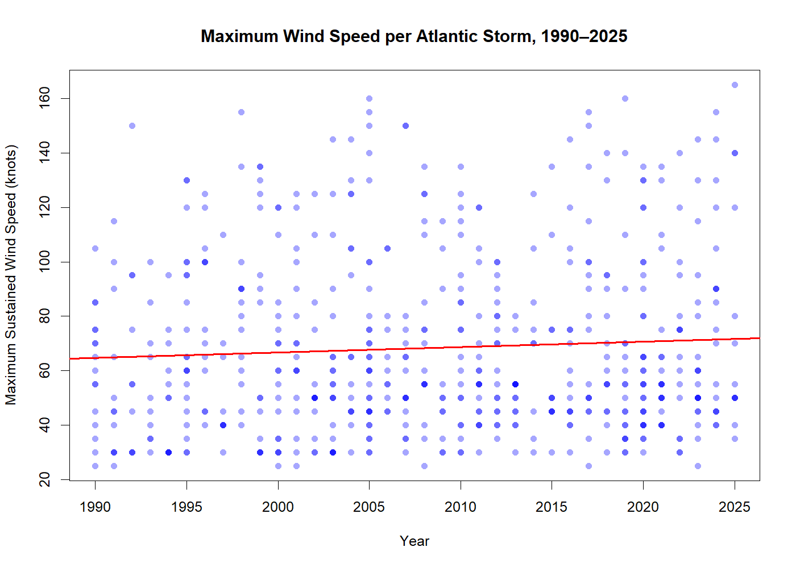
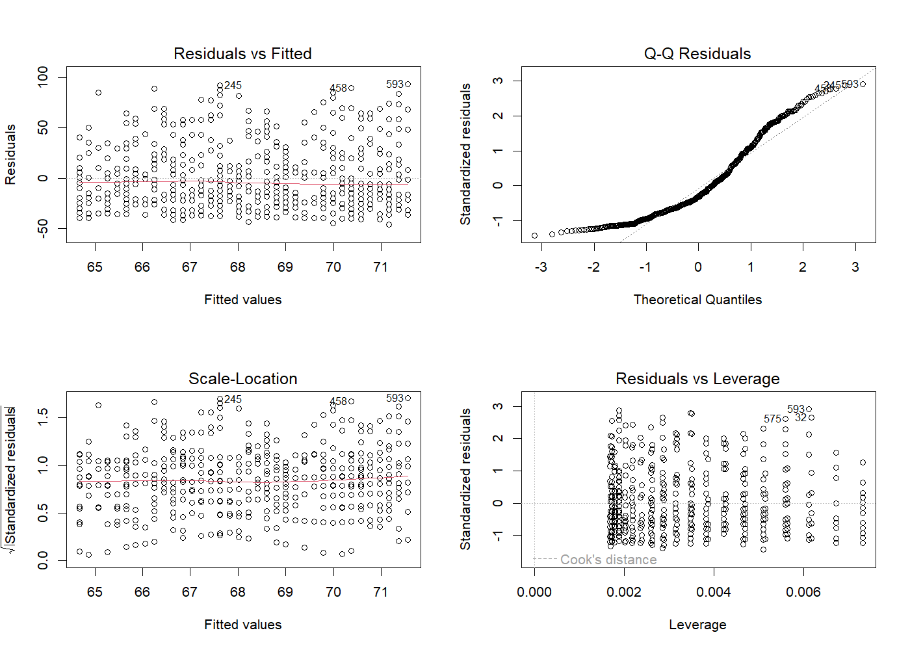

# Atlantic Hurricane Intensity Analysis (1990–2025)

**Statistical analysis of NOAA's Atlantic Hurricane Database (HURDAT2)**  
**Author:** Kaleena Ann LaBerge  
**Tools:** R, descriptive statistics, Pearson correlation, simple linear regression, Spearman correlation, regression diagnostics

## Project overview

This project explores whether the year in which an Atlantic tropical or subtropical cyclone occurred is associated with its **maximum recorded sustained wind speed** between 1990 and 2025.

The NOAA/National Hurricane Center HURDAT2 data were cleaned and aggregated from **17,820 six-hourly observations** into **593 individual storm records**, one maximum wind-speed observation per storm. This aggregation reduces the within-storm dependence that would arise from treating repeated measurements as independent storms.

## Research question

> Is there a statistically significant linear relationship between calendar year and the maximum recorded sustained wind speed of individual Atlantic tropical and subtropical cyclones from 1990–2025?

## Methods

- Select Atlantic records from 1990 through 2025.
- Convert the raw HURDAT2 storm records into analyzable variables.
- Aggregate repeated storm observations into storm-level maximum sustained wind speeds.
- Fit a simple linear regression of storm maximum wind speed on calendar year.
- Evaluate regression assumptions using residual plots.
- Check sensitivity using Spearman rank correlation and year-clustered standard errors.

## Data Visualizations

### Atlantic Storm Maximum Wind Speed (1990–2025)

**Figure 1.** Maximum recorded sustained wind speed for individual Atlantic storms from 1990–2025. The fitted regression line indicates a weak positive association between year and maximum wind speed; however, the relationship was not statistically significant (p = .1317).

### Regression Diagnostic Plots

**Figure 2.** Four-panel diagnostic plots for the storm-level linear regression model. These plots were used to examine residual patterns, normality, variability, and influential observations.

## Results

| Metric | Result |
| --- | ---: |
| Storms analyzed | 593 |
| Six-hourly observations used in preparation | 17,820 |
| Pearson correlation | 0.0620 |
| Regression slope | 0.1965 knots/year |
| Linear relationship p-value | 0.1317 |
| R-squared | 0.003841 (about 0.38%) |
| Spearman correlation | 0.0570 (p = 0.1655) |
| Year-clustered regression p-value | 0.1373 |

**Interpretation:** The estimated relationship was weakly positive but **not statistically significant** at α = .05. This result does **not** establish that hurricane intensity is unchanged or rule out other climate-related trends; it reflects this particular outcome, region, period, and linear model.

## Project files

- [`Atlantic_Hurricane_Research.docx`](Atlantic_Hurricane_Research.docx): research report, statistical results, methodology, visualizations, and references.

The original R source scripts and individually exported figures are **not included in this initial release**. They will be added when verified from the original analysis. The report contains the existing study figures.

## Data source

National Hurricane Center (NHC), **HURDAT2 Atlantic hurricane database**: https://www.nhc.noaa.gov/data/

The source data belong to their respective providers and are not included in this repository.

## Reproducibility status

The report documents the methodology and findings. Full code-level reproduction will require adding the original R parsing, aggregation, modeling, and plotting scripts. No unverified code has been presented as original research code.

## Portfolio

[Professional website](https://kaleenaann.github.io/) · [LinkedIn](https://www.linkedin.com/in/kaleena-ann-laberge)
